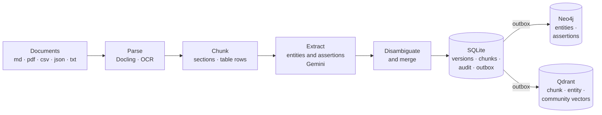
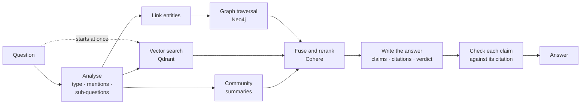

# GraphRAG

**Question answering over your own documents that cites its evidence, gives a yes or no when
asked, and refuses when the documents don't say.** GraphRAG builds a knowledge graph and a
vector index from a document collection and retrieves evidence from both. An LLM then writes
the answer as claims, and each claim is checked against the passage it cites before the
answer is shown.

**Status:** working end to end on a 760-document corpus: news articles, encyclopedia entries,
research papers and a CSV. Every design choice was measured against judged question sets
before it was adopted.

## Highlights

- **Three kinds of evidence, one ranking.**
  - Graph traversal from the entities a question names.
  - Dense vector search.
  - Summaries of entity communities, for questions about the whole corpus.

  The three are fused and reranked with Cohere.
- **Answers you can check.**
  - Every claim cites a stored passage.
  - A claim its citation does not support is dropped.
  - Yes/no questions get an explicit verdict, and questions the corpus cannot answer are
    refused.
- **Ingestion that cannot half-finish.**
  - A document version is staged in SQLite and written to Neo4j and Qdrant through an outbox.
    It becomes visible only when every store has confirmed.
  - Re-ingesting re-extracts only the text that changed and reuses embeddings that did not.
  - Removing a document removes it everywhere.
- **Entities resolved across documents.** Disambiguation within a document, then merging
  across documents with LLM adjudication. Every merge decision is audited and reversible.
- **PDFs, including awkward ones.** Docling parsing, OCR for pages without a text layer, and a
  page-coverage report for each document.
- **Runs as a service.**
  - A FastAPI service with conversational follow-ups, and a web console.
  - Scheduled jobs.
  - A count of every model call, per run and per month.

## Architecture

**Ingestion.** Documents become versioned chunks, entities and assertions, written atomically
across three stores.



**Querying.** The vector search on the question starts while it is being analysed. Graph
retrieval waits only for entity linking.



Redis caches answers, keyed to the current state of the corpus, and holds conversation
sessions. Without Redis, an in-process cache stands in.

| Folder | Contents |
|---|---|
| `ingestion/` | Parsing, chunking, extraction, disambiguation, cross-document merging, the outbox and stores |
| `retrieval/` | Question analysis, entity linking, the graph, vector and community retrievers, fusion, reranking, the cache |
| `generation/` | The answer prompt, claim validation, yes/no verdicts |
| `api/` | The FastAPI service and the web console |
| `background/` | Scheduled jobs: community rebuilds, a nightly graph-health report |
| `eval/` | Judged question sets, the evaluation harness, metrics, the faithfulness judge |
| `observability/` | Tracing and provider-call accounting |
| `scripts/` | Corpus rebuilds, re-embedding, integrity checks |
| `docs/` | The architecture reference, the roadmap, and design and incident records |

## How it works

### Storage: three stores, one owner

- **SQLite is the system of record.** It holds documents, their versions, chunks, merge
  decisions, extraction audit, and an outbox of pending writes, and it decides what is live.
- **Neo4j holds facts as reified assertions:**
  `(Entity)-[:SUBJECT_OF]->(Assertion)-[:OBJECT]->(Entity | value)`.
  - Each assertion carries the document version and chunk it came from, so every fact can be
    cited, versioned and retracted on its own.
  - The same claim made by two documents shares a `claim_key`.
- **Qdrant holds the vectors** for chunks, entities and community summaries.
  - Each vector is stamped with the embedding contract that produced it: model, dimension,
    prompt and schema versions.
  - A vector from a different contract is never mixed into a search.

### Ingestion

- **Parsing.**
  - PDFs go through Docling. Pages it drops are recovered from the text layer.
  - A page with no text layer is rendered: a blank page is recorded as blank, and anything else
    is read by OCR.
  - Tables become one chunk per row and are extracted in batches, so each fact stays filed
    under its own row.
- **Extraction.** Gemini reads each chunk and returns entities and assertions.
  - A chunk whose extraction fails is quarantined.
  - The document fails only if more than 5% of its chunks do.
- **Versioned, all-or-nothing writes.**
  - A new version is staged in SQLite and sent to Neo4j and Qdrant as outbox events.
  - Each store is checked for that version, and only then does it become active, retiring the
    previous one in the same step.
  - Every read is fenced to active versions, so a half-written or superseded version is never
    served.
  - Interrupted runs resume, and a sweeper retracts versions that were abandoned.
- **Doing only what changed.**
  - A pipeline fingerprint records every setting that shapes extraction.
  - Unchanged chunks keep their assertions, and unchanged text keeps its vectors: a
    one-sentence edit re-embedded 1 chunk of 6.

### Entity identity

- **Within a document,** mentions of one entity are clustered. A surname joins the full name
  that contains it, and names made of the same words in another order stay apart unless they
  are people.
- **Across documents,** each new entity is compared with existing ones by embedding similarity:
  - 0.95 or above, with compatible types, merges automatically;
  - 0.80–0.95 goes to an LLM adjudicator;
  - anything below becomes a new entity.

  A lexical check stands behind the model.
- **Every decision is recorded** with its scores, and any merge can be rolled back
  (`main_admin.py rollback-merge`).

### Retrieval

- **Analysis.** Gemini classifies the question (local, multi-hop, comparative or global), lists
  the entities it mentions, and splits it into sub-questions. A follow-up is rewritten as a
  standalone question.
- **Three channels run concurrently:**
  - **Graph traversal.** A breadth-first expansion from the linked entities: one bounded,
    parameterised query per hop, with a fan-out cap. The model never writes Cypher.
  - **Vector search** over the question and its sub-questions, with MMR for diversity.
  - **Community summaries** for questions about the corpus as a whole. Louvain communities of
    the entity graph are summarised by Gemini.
- **Ranking.** Reciprocal rank fusion (k = 60), then Cohere `rerank-v4.0-pro` over the top
  candidates.

### Answering

Gemini returns structured output: an `answerable` flag, a prose answer, and claims that each
cite evidence IDs. Before anything is shown, every claim is checked:

- its citations must be among the retrieved evidence;
- an assertion it cites must state the value it claims;
- a publication it names must be the one the evidence comes from.

Failing claims are regenerated once and then dropped, and the prose is rewritten over the claims
that survive. Yes/no questions also get a `verdict` field. An unanswerable question gets a
refusal, not a guess.

### Reliability

- **Every stage has its own deadline.** A failed stage degrades instead of failing the question:
  no reranker means fused order, and no graph means vectors only. The answer's warnings say
  which stage degraded.
- **Degraded answers are never cached.** The answer cache is keyed to the state of the corpus,
  so any ingest or removal invalidates it.

## Design decisions

Every choice with a figure beside it was adopted against a bar set before it was measured.

| Decision | Why | Measured |
|---|---|---|
| Facts as assertion nodes, not edges | Per-fact provenance, versioning and retraction; claims comparable across documents | — |
| Outbox writes with active-version fencing | A failure must never leave a half-written document readable | A build survived a 4-hour Qdrant outage and a network drop. All 176 failed documents were retried, and 16/16 integrity checks passed |
| Graph traversal owned by the application, not Cypher written by the LLM | Predictable cost, and no model-authored queries run against the database | LLM-planned traversal returned half the graph evidence; gold hit rate fell from 0.633 to 0.500 |
| Cohere reranking | Rank fusion alone ordered evidence poorly | MRR rose from 0.662 to 0.809 with recall unchanged. Cross-encoders made ranking worse, and an LLM reranker was neutral |
| Claims checked against their citations | An answer is only as good as its weakest sentence | Claim faithfulness 0.91–0.98, from a judge that made no errors on 103 hand-labelled claims |
| An explicit yes/no verdict | Yes/no answers used to hedge | Correct verdicts rose from 15/41 to 32/41 |
| Follow-ups rewritten into standalone questions | Retrieval needs the full question | Follow-ups answered rose from 5/30 to 21/30, the same as asking them in full |
| Relaxed lexical check behind merge decisions | A strict check vetoed merges the model had judged correctly | Vetoed good merges fell from 382 to 145 |
| Independent stages overlapped | Waiting, not work, set the latency | 1.26 s off the median, with evidence unchanged |

**Measured and rejected,** with each one's numbers kept in `docs/`:

- coreference annotation;
- sparse keyword retrieval;
- LLM-planned graph queries;
- community passages for global questions;
- a re-tuned entity-link weight;
- two rewrites of the yes/no instruction.

## Quick start

You need Python 3.13, Docker, a Gemini API key and, for reranking, a Cohere API key.

```bash
# 1. Install
python -m venv venv
source venv/bin/activate              # Windows: venv\Scripts\activate
pip install -r requirements.txt

# 2. Configure: set GEMINI_API_KEY, COHERE_API_KEY and NEO4J_PASSWORD
cp .env.example .env

# 3. Start Neo4j, Qdrant and Redis (bound to 127.0.0.1)
docker compose up -d

# 4. Ingest a folder of documents
python main_ingest.py --input data/my-documents

# 5. Ask
python main_query.py --query "What do the documents say about the antitrust case?"
python main_query.py --chat           # follow-up questions keep their context
```

### Service and console

```bash
python main_api.py                    # console at http://127.0.0.1:8000 · API reference at /docs
```

The console has three tabs:

- **Ask:** an answer with its verdict, its claims and the cited passages.
- **Corpus:** the documents, ingest jobs and removal.
- **Graph:** entity types, predicates, growth over time and communities.

| Endpoint | Purpose |
|---|---|
| `POST /query` | Ask a question; pass a `session_id` for follow-ups |
| `GET /documents`, `GET /documents/{id}` | The corpus, and one document's versions and page coverage |
| `POST /ingest`, `DELETE /documents/{id}` | Ingest a path under `data/`, or remove a document, as background jobs |
| `GET /jobs`, `POST /jobs/{kind}` | Job status; run a scheduled job now |
| `GET /graph/overview` | Schema and growth of the graph |
| `GET /health` | Store status, models, page coverage, Cohere calls this month |

The API listens only on localhost. To serve it beyond localhost, set `API_TOKEN`; every request
must then send `Authorization: Bearer <token>`.

### Operating

| Task | Command |
|---|---|
| Remove a document (a dry run without `--apply`) | `python main_admin.py remove-document --path <file> --apply` |
| Rebuild community summaries | `python main_admin.py communities` |
| Run any background jobs that are due | `python main_admin.py due-jobs --run` |
| Measure the corpus | `python main_admin.py corpus-health` |
| PDF page coverage | `python main_admin.py page-coverage --write` |
| Finish writes left by an interrupted ingest | `python main_admin.py reconcile` |
| Rebuild a corpus into fresh stores, resumably | `python scripts/rebuild_corpus.py --filelist <list> --metadata-db <db> --resume` |

## Configuration

Every setting is in `.env.example`, with the measurement behind each default. These are the
ones you are likely to change:

| Setting | Purpose |
|---|---|
| `GEMINI_API_KEY` | Required |
| `COHERE_API_KEY` | Reranking. Without it, results stay in fused order, at an MRR of about 0.68 (measured) |
| `NEO4J_PASSWORD` | The graph store; `docker compose` will not start without it |
| `GEMINI_MODEL` | Question analysis and answers (default `gemini-3.5-flash-lite`) |
| `INGESTION_MODEL` | Extraction, merge decisions and community summaries (default `gemini-3.8-flash`). Changing it re-extracts the corpus |
| `EMBEDDING_MODEL_ID` | Default `gemini-embedding-001`. Changing it means re-embedding |
| `QUERY_RERANK_MIN_INTERVAL_SECONDS` | Minimum gap between Cohere calls: 6.5 for a trial key, 0 for a production key |
| `METADATA_DB_PATH`, `QDRANT_*_COLLECTION` | Which corpus the tools use. Leave them unset for a fresh deployment |
| `REDIS_URL` | Answer cache and sessions (optional) |
| `API_TOKEN` | Required to serve beyond localhost |
| `TRACING_ENABLED` | OpenTelemetry traces to a Phoenix collector (optional) |

## Evaluation

```bash
python main_eval.py run --goldset eval/goldset_wp2f_comparison.jsonl --judge --label my-run
```

Each run writes `report.md` and `report.json` to `artifacts/eval/` with:

- retrieval and citation metrics;
- claim faithfulness;
- yes/no verdicts and abstention;
- stage latency;
- every model call the run made.

A run stops itself if Cohere starts refusing calls, so a dead key does not waste the rest of
it.

**Current results** (October 2026, on the 760-document corpus):

| Question set | Questions | MRR | Recall@10 | Claim faithfulness |
|---|---:|---:|---:|---:|
| News (MultiHop-RAG) | 50 | 0.837 | 0.98 | 0.91 |
| Held-out news | 60 | 0.878 | 1.00 | 0.95 |
| Research papers (PDF) | 51 | 0.941 | 1.00 | 0.98 |

| Measure | Result |
|---|---|
| Yes/no verdicts | 35/41 |
| Entity answers | 66/68 |
| PDF answers | 46/47 |
| Must-refuse questions | 19/20 refused, with 10/10 answerable controls answered |
| Corpus-wide theme recall | 0.64 |
| Median time per answer | 7.6 s |

**Claim faithfulness** is the share of answer claims that an LLM judge finds supported by the
passages they cite. The judge was checked against hand-labelled claims and produced no false
rejections in 35 and no false acceptances in 68.

The corpus is 609 news articles (MultiHop-RAG), 100 Re-DocRED documents, 50 arXiv papers and a
CSV. It is not included in the repository.

A change is adopted only under a decision rule written before its run. Rejected changes are
kept with their numbers; see `docs/ROADMAP.md`.

## Limitations

- **Speed:** about 7.6 s per answer at the median. Analysis, reranking and writing the answer
  are each a model call.
- **Cohere trial keys** allow 1,000 calls a month, with 6.5 s between calls.
- **Comparison yes/no questions** are the weakest kind, at 15 of 21 right. Two of their
  benchmark labels are contested.
- **Corpus-wide theme questions** recall about two-thirds of the expected themes.
- **Language and provider:** built and measured on English text, with Gemini for extraction,
  answers and embeddings.

## Development

```bash
python -m pytest tests/unit           # about 790 tests; no services or API keys needed
```

Continuous integration (`.github/workflows/ci.yml`):

1. installs the pinned requirements;
2. runs `pip check`;
3. compiles the code;
4. runs the unit tests.

Design history: `docs/ROADMAP.md` covers the plan and every measured decision,
`docs/GraphRAG_Architecture_Reference.docx` is the architecture reference, and
`docs/ERRORS.md` is the incident log.
